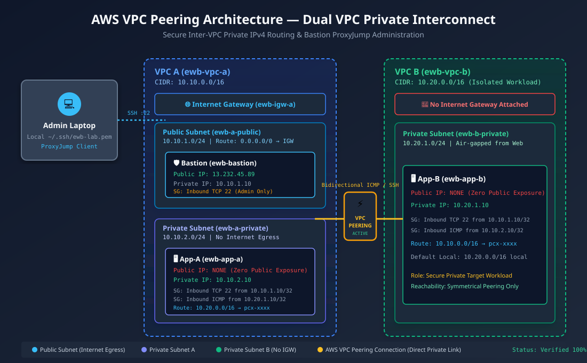

# AWS VPC Peering: Connect Two VPCs and Prove Private Connectivity

[](https://github.com)
[](https://aws.amazon.com/vpc/)
[](https://www.terraform.io/)
[](https://boto3.amazonaws.com/)
[](./test_evidence/TEST_EVIDENCE.md)

An end-to-end cloud networking engineering project connecting two isolated Amazon VPCs (`10.10.0.0/16` and `10.20.0.0/16`) via a private AWS VPC Peering connection, validating cross-VPC private IPv4 connectivity, enforcing zero public IP exposure on backend workloads, demonstrating secure OpenSSH `ProxyJump` jump-host administration, and conducting controlled failure/recovery validation.

---

## 📐 Architecture Topology

The network implements direct, non-transitive Layer 3 peering between two non-overlapping VPCs:



---

## 📁 Repository Structure

```text
├── .github/
│   └── workflows/
│       └── pages.yml              # Automated GitHub Pages Live Showcase deployment
├── diagrams/
│   └── architecture.svg           # High-resolution vector network architecture diagram
├── docs/
│   ├── PRD.md                     # Product Requirements Document
│   ├── TRD.md                     # Technical Requirements Document
│   ├── TROUBLESHOOTING_AND_VIVA.md# Troubleshooting Playbook & Viva Technical Defense
│   └── aws_inventory.json         # Deployment resource configuration inventory
├── scripts/
│   ├── deploy.py                  # Automated AWS Boto3 infrastructure provisioner
│   ├── run_tests.py               # Test runner & evidence generator (TC-01 to TC-07)
│   └── cleanup.py                 # 100% Resource teardown & cost-control engine
├── terraform/
│   ├── main.tf                    # Complete Terraform VPC, Subnet, Peering & EC2 config
│   ├── provider.tf                # AWS provider settings & default tags
│   ├── variables.tf               # Configurable region, CIDR, and key variables
│   └── outputs.tf                 # Generated resource IDs and IP outputs
├── test_evidence/
│   ├── TEST_EVIDENCE.md           # Markdown test log with actual terminal execution output
│   └── test_results.json          # Structured machine-readable test outputs
├── web/
│   └── index.html                 # Interactive live web dashboard and evidence viewer
├── .gitignore                     # Git safeguards ignoring .pem, tfstate, and secrets
└── README.md                      # Project documentation and reproduction guide
```

---

## 🌐 IP Addressing Plan

| Resource Name | Logical Component | IPv4 CIDR / Address | Route Table Association | Security Group |
|---|---|---|---|---|
| `ewb-vpc-a` | Requester VPC | `10.10.0.0/16` | Default | - |
| `ewb-a-public` | Public Subnet | `10.10.1.0/24` | `ewb-rt-a-public` | - |
| `ewb-a-private` | Private Subnet A | `10.10.2.0/24` | `ewb-rt-a-private` | - |
| `ewb-vpc-b` | Accepter VPC (No IGW) | `10.20.0.0/16` | Default | - |
| `ewb-b-private` | Private Subnet B | `10.20.1.0/24` | `ewb-rt-b-private` | - |
| `ewb-bastion` | Bastion Host (t2.micro) | `10.10.1.10` + Public IP | In `ewb-a-public` | `ewb-sg-bastion` |
| `ewb-app-a` | Workload Instance A | `10.10.2.10` (No Public IP) | In `ewb-a-private` | `ewb-sg-app-a` |
| `ewb-app-b` | Workload Instance B | `10.20.1.10` (No Public IP) | In `ewb-b-private` | `ewb-sg-app-b` |
| `ewb-a-b-peer` | Peering Connection | `pcx-xxxx` (Active) | Targets in all 3 RTs | - |

---

## 🧪 Verification Matrix & Test Evidence (7/7 Passed)

| Test ID | Test Objective | Expected Behavior | Result |
|---|---|---|---|
| **TC-01** | Baseline Reachability (Pre-Peering) | 100% Packet Loss (No route to host) | :white_check_mark: **PASSED** |
| **TC-02** | Forward ICMP (App-A &rarr; App-B) | 4 packets transmitted, 4 received (0% loss) | :white_check_mark: **PASSED** |
| **TC-03** | Return Path ICMP (App-B &rarr; App-A) | 4 packets transmitted, 4 received (0% loss) | :white_check_mark: **PASSED** |
| **TC-04** | Private SSH via ProxyJump | Direct encrypted shell to App-B (10.20.1.10) | :white_check_mark: **PASSED** |
| **TC-05** | Private Workload Audit | App-A & App-B have zero public IP addresses | :white_check_mark: **PASSED** |
| **TC-06** | Controlled Failure Injection | Revoke ICMP ingress; ping drops immediately | :white_check_mark: **PASSED** |
| **TC-07** | Controlled Recovery | Reinstate ICMP ingress; ping recovers immediately | :white_check_mark: **PASSED** |

> Complete terminal outputs and execution logs are available in [TEST_EVIDENCE.md](./test_evidence/TEST_EVIDENCE.md).

---

## 🚀 How to Deploy & Reproduce

### Option A: Using Terraform (Infrastructure-as-Code)
```bash
cd terraform
terraform init
terraform plan
terraform apply -auto-approve
```

### Option B: Using Python Automation (Boto3)
```bash
# Set your AWS credentials
export AWS_DEFAULT_REGION="ap-south-1"

# Run automated deployment
python scripts/deploy.py --region ap-south-1 --student "YourName"

# Run verification test suite
python scripts/run_tests.py
```

### Clean Up Resources (Prevent Billing)
```bash
# If using Python:
python scripts/cleanup.py

# If using Terraform:
cd terraform && terraform destroy -auto-approve
```

---

## 🔒 Security Best Practices Implemented

1. **Zero Public IP Exposure**: App-A and App-B have no public IPv4 addresses and no default route to an Internet Gateway.
2. **OpenSSH ProxyJump**: Private keys remain on the local workstation (`chmod 400`). The bastion is used purely as an encrypted L4 network jump without storing credentials.
3. **Hypervisor-Level Least Privilege**: Inbound security groups restrict SSH and ICMP strictly to explicit `/32` host IPs.
4. **Secrets Quarantine**: `.gitignore` prevents private keys (`.pem`), AWS credentials, and Terraform state files from ever being committed to Git.
